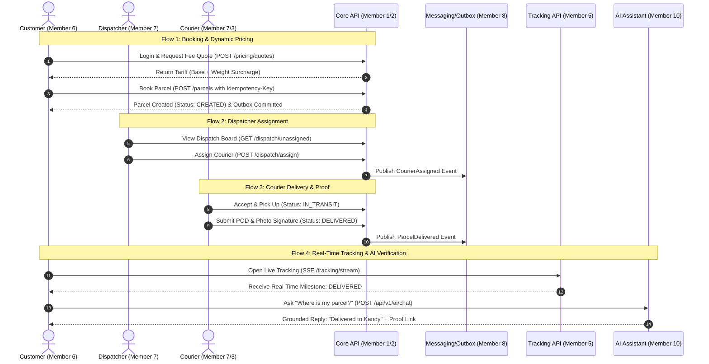
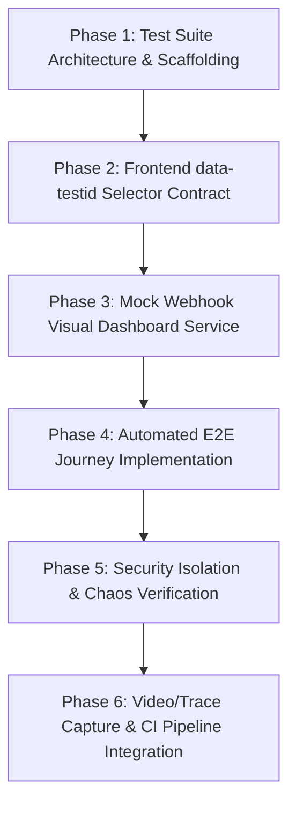

# SwiftDrop Cross-Module Quality & End-to-End Testing — Implementation Roadmap

> **Domain / Mandate:** Cross-Workflow Quality Assurance & Multi-Actor E2E Testing  
> **Primary Lead / Owner:** Member 10 — Cross-Workflow Quality Coordination & AI Assistant  
> **Collaborating Domain Owners:** Members 1 through 9 (All Domain Owners)  
> **Evaluation Rubric:** **15 Marks** for End-to-End Integration, Live Demo, and Automated Acceptance  
> **Test Framework:** Playwright (Python / `pytest-playwright`), Docker Compose, GitHub Actions  
> **Test Artifact Port:** `mock-webhook:9999` (Visual Webhook Dashboard)

---

## 1. Executive Summary & Purpose

While individual members write unit and integration tests inside their own modules (`core-api/internal/`, `services/messaging/`, `services/tracking/`), **Member 10 owns the cross-workflow quality gate**. 

This roadmap governs the creation, automation, and live presentation of the **Cross-Module End-to-End (E2E) Test Suite** (`tests/e2e/`). It proves that all independently developed subsystems function harmoniously under real-world conditions, enforcing:
1. Multi-actor transactional integrity across asynchronous boundaries (Outbox, RabbitMQ, SSE).
2. Strict multi-tenant isolation with zero data leakage (`SEC-004`, `SEC-005`).
3. Complete visual evidence capture (headless video, traces, screenshots) for academic grading.

---

## 2. System-Wide Test Architecture & Infrastructure

```
                                  CROSS-MODULE E2E TEST ARCHITECTURE
                                  
   ┌────────────────────────────────────────────────────────────────────────────────────────┐
   │                          Playwright Multi-Actor Test Runner                            │
   │                                                                                        │
   │   [Actor 1: Customer]      [Actor 2: Dispatcher]    [Actor 3: Courier]  [Actor 4: AI] │
   │   Context: User Profile    Context: Admin Portal    Context: Mobile PWA Context: MCP   │
   └─────────────┬────────────────────────┬──────────────────────┬──────────────────┬───────┘
                 │                        │                      │                  │
                 ▼                        ▼                      ▼                  ▼
   ┌────────────────────────────────────────────────────────────────────────────────────────┐
   │                        Traefik API Gateway & Ingress (:80)                            │
   └───────┬──────────────────────────────┬───────────────────────────────┬─────────────────┘
           │                              │                               │
           ▼                              ▼                               ▼
    [Core API: 8080]               [Tracking API: 8081]          [AI Assistant: 8000]
    (PostgreSQL Storage)           (Redis / SSE Projections)     (FastMCP & Chatbot)
           │                                                              │
           ▼ (Outbox Commit)                                              ▼ (Read-Only)
    [Outbox Relay] ──► [RabbitMQ Bus] ──► [Event Worker] ────────► [mock-webhook:9999]
                                                                  (Visual Multi-Tenant
                                                                   Dashboard & DLQ Test)
```

### Multi-Actor Browser Isolation Standard
Playwright tests **must never share browser storage or cookies** across actors. Tests utilize `browser.new_context()`:
- `customer_context`: Logged in as `customer@swiftdrop.local`.
- `dispatcher_context`: Logged in as `dispatcher@swiftdrop.local`.
- `courier_context`: Logged in as `courier@swiftdrop.local`.
- `merchant_context`: Logged in as `merchant@vendor.com` (Tenant `mrc_01HMERCHANTTENANT00001`).

---

## 3. The 4 Mandatory Demonstration Flows (15-Mark Rubric)



---

## 4. Standalone Test Artifact: `mock-webhook:9999`

To make asynchronous background event dispatching tangible during grading, Member 10 provides the **Standalone Multi-Tenant Mock Webhook Receiver & Visual HTML Dashboard**:

### 4.1 Architecture & Endpoints
- **Service Name:** `mock-webhook` running on port `9999`.
- **Target Callers:** Member 8's Event Worker.
- **Key Endpoints:**
  - `POST /webhooks/merchant-alpha`: Ingests webhooks for Merchant Alpha, validates HMAC-SHA256 signature, increments Alpha counter.
  - `POST /webhooks/merchant-beta`: Ingests webhooks for Merchant Beta, validates HMAC, increments Beta counter.
  - `POST /webhooks/merchant-chaos`: Always returns `HTTP 500 Internal Server Error` to trigger worker retry policy and demonstrate **Dead-Letter Queue (`swiftdrop.dlq`)** routing.
  - `POST /webhooks/merchant-slow`: Sleeps for 10 seconds to test worker HTTP client timeout enforcement.
  - `GET /dashboard`: Responsive Tailwind HTML visual dashboard showing live incoming webhook feeds, payload JSONs, signature badges, and multi-tenant isolation meters.
  - `GET /api/merchants/{id}/events`: JSON endpoint for Playwright automated assertions.
  - `POST /api/reset`: Flushes memory between test runs.

### 4.2 Proving Multi-Tenant Isolation (`SEC-004` / `SEC-005`)
When Merchant Alpha triggers an order:
- Event appears strictly in Alpha's feed.
- Merchant Beta's counter stays at `0`.
- Dashboard renders green visual badge: `[TENANT ISOLATION VERIFIED: ZERO DATA LEAKAGE]`.

---

## 5. Phased Quality Roadmap



---

### Phase 1: Test Suite Architecture & Scaffolding
**Objective:** Set up the Playwright testing harness and multi-actor fixtures.

- [ ] **1.1 Directory Structure Creation:**
  ```
  tests/e2e/
  ├── fixtures/
  │   ├── auth_fixtures.py        # Pre-authenticated context helpers (Customer, Dispatcher, Courier)
  │   ├── test_data.py            # Stable seed credentials, postal codes, and dimensions
  │   └── gateway_client.py       # REST API helper for pre-seeding test data
  ├── helpers/
  │   ├── selectors.py            # Central repository of data-testid selectors
  │   ├── sse_listener.py         # Async SSE stream listener for real-time tracking tests
  │   └── evidence.py             # Automatic screenshot and trace bundler
  ├── flows/
  │   ├── test_flow_1_booking.py  # Customer fee estimation and booking wizard
  │   ├── test_flow_2_dispatch.py # Dispatcher assignment and fleet management
  │   ├── test_flow_3_courier.py  # Courier mobile PWA pickup and POD submission
  │   ├── test_flow_4_tracking.py # Public SSE tracking and AI assistant lookup
  │   └── test_flow_security.py   # IDOR, tenant boundary, and rate-limiting tests
  ├── mock-webhook/               # Standalone test artifact container
  │   ├── app.py                  # FastAPI webhook receiver & SSE dashboard
  │   ├── templates/
  │   │   └── dashboard.html      # Visual multi-tenant dashboard
  │   ├── Dockerfile              # Lightweight container image
  │   └── requirements.txt        # fastapi, uvicorn, jinja2
  ├── artifacts/                  # Generated video recordings, traces, and screenshots
  ├── conftest.py                 # Pytest fixtures and browser lifecycle
  ├── pytest.ini                  # Pytest configuration
  ├── requirements.txt            # pytest-playwright, httpx, sseclient-py
  └── README.md                   # Execution and debugging manual
  ```
- [ ] **1.2 Install Playwright Browsers:** Scripted command to install headless Chromium and Firefox.
- [ ] **1.3 Multi-Actor Fixtures (`conftest.py`):** Provide `customer_page`, `dispatcher_page`, `courier_page` fixtures.

---

### Phase 2: Frontend Selector Contract (`data-testid`)
**Objective:** Agree on unambiguous, resilient selectors with Members 6 & 7.

- [ ] **2.1 Standardize Selectors:**
  - Login: `data-testid="input-email"`, `data-testid="input-password"`, `data-testid="btn-login"`.
  - Booking: `data-testid="input-weight"`, `data-testid="select-service-type"`, `data-testid="btn-get-quote"`, `data-testid="quote-amount"`, `data-testid="btn-submit-booking"`, `data-testid="booking-tracking-number"`.
  - Dispatch: `data-testid="dispatch-unassigned-table"`, `data-testid="btn-assign-courier"`, `data-testid="select-courier"`.
  - Courier: `data-testid="courier-task-list"`, `data-testid="btn-pickup"`, `data-testid="btn-deliver"`, `data-testid="file-pod-signature"`.
  - Tracking: `data-testid="input-tracking-search"`, `data-testid="milestone-status"`, `data-testid="sse-status-indicator"`.
  - AI Chat: `data-testid="ai-chat-bubble"`, `data-testid="input-ai-prompt"`, `data-testid="btn-send-ai"`, `data-testid="ai-action-card-booking"`.

---

### Phase 3: Multi-Tenant Mock Webhook Visual Dashboard Service
**Objective:** Implement and containerize `mock-webhook:9999`.

- [ ] **3.1 Backend Receiver (`tests/e2e/mock-webhook/app.py`):**
  - Implement HMAC verification against shared secret `whsec_alpha_...`.
  - Maintain in-memory lists of received CloudEvents per tenant.
  - Implement chaos simulation (HTTP 500) and slow simulation (sleep 10s).
- [ ] **3.2 Visual HTML Dashboard (`dashboard.html`):**
  - Responsive Tailwind CSS dark-mode dashboard.
  - Real-time event counter with badge: `[TENANT ISOLATION VERIFIED]`.
  - Accordion for viewing raw JSON payload headers and CloudEvent timestamps.
- [ ] **3.3 Docker Compose Integration:** Add `mock-webhook` service on port `9999:9999` in `deploy/docker-compose.yml`.

---

### Phase 4: Automated Multi-Actor E2E Implementation
**Objective:** Codify the 4 core business flows.

- [ ] **4.1 Flow 1 (`test_flow_1_booking.py`):**
  - Logs in Customer.
  - Fills weight (`2.5 kg`), dimensions, postal codes.
  - Asserts fee quote matches Member 2's tariff formula.
  - Clicks submit; captures tracking number `SD-YYYYMMDD-XXXXX`.
  - Asserts status is `CREATED`.
- [ ] **4.2 Flow 2 (`test_flow_2_dispatch.py`):**
  - Logs in Dispatcher.
  - Finds the newly created parcel on the unassigned board.
  - Assigns Courier (`courier@swiftdrop.local`).
  - Asserts status changes to `ASSIGNED`.
- [ ] **4.3 Flow 3 (`test_flow_3_courier.py`):**
  - Logs in Courier on mobile-viewport context.
  - Marks parcel `PICKED_UP` $\rightarrow$ `IN_TRANSIT`.
  - Attaches mock proof-of-delivery signature/image.
  - Marks parcel `DELIVERED`.
- [ ] **4.4 Flow 4 (`test_flow_4_tracking.py`):**
  - Opens public tracking page for the tracking number.
  - Connects to SSE stream; verifies milestone updates to `DELIVERED`.
  - Opens AI Chatbot widget; asks *"Where is parcel SD-..."*.
  - Asserts AI assistant replies with delivery confirmation and city location.

---

### Phase 5: Security Isolation & Chaos Verification
**Objective:** Validate security boundaries (`SEC-001` through `SEC-011`).

- [ ] **5.1 Tenant Isolation & IDOR Test (`test_flow_security.py`):**
  - Customer A attempts to access Customer B's parcel details via direct URL or API call $\rightarrow$ asserts `403 Forbidden` / `404 Not Found`.
- [ ] **5.2 Public Tracking Masking (`SEC-009`):**
  - Inspects public tracking page and API response $\rightarrow$ asserts recipient phone number and street address are strictly omitted.
- [ ] **5.3 Webhook Failure & DLQ Test:**
  - Triggers webhook to `merchant-chaos` $\rightarrow$ asserts Event Worker retries with exponential backoff and routes to Dead-Letter Queue.

---

### Phase 6: Automated Evidence Capture & CI Pipeline Integration
**Objective:** Generate evaluation deliverables automatically.

- [ ] **6.1 Video & Trace Recording:**
  - Configure Playwright to record video for all test runs.
  - Save video files to `tests/e2e/artifacts/videos/`.
  - Save trace files to `tests/e2e/artifacts/traces/` (viewable via `playwright show-trace`).
- [ ] **6.2 Automated HTML Summary Report:**
  - Pytest HTML report generator outputting full test run results with embedded failure screenshots.
- [ ] **6.3 GitHub Actions CI Workflow (`.github/workflows/e2e.yml`):**
  - Spins up Docker Compose environment.
  - Waits for healthchecks on Core API, Tracking API, and Mock Webhook.
  - Executes E2E test suite.
  - Uploads video and trace artifacts for grading review.

---

## 6. Live Demo Execution & Examiner Presentation Script

For the **15-mark Live Demonstration**:

1. **Setup:** Run `docker-compose up -d`. Open two browser windows:
   - Window 1: SwiftDrop Web Portal (`http://localhost:3000`).
   - Window 2: Mock Webhook Visual Dashboard (`http://localhost:9999/dashboard`).
2. **Action 1 (Customer & AI):** Customer interacts with AI Assistant to get a shipping quote; AI generates 1-click booking card; customer confirms booking.
3. **Action 2 (Dispatcher):** Dispatcher assigns courier in realtime.
4. **Action 3 (Courier):** Courier on mobile view completes pickup and attaches digital POD.
5. **Action 4 (Realtime Verification):** Customer tracking screen updates instantly via SSE.
6. **Action 5 (Webhook Proof):** Switch to `http://localhost:9999/dashboard`—point to incoming webhook receipt and green **Tenant Isolation Verified** badge.

---

## 7. Quality Acceptance Checklist

| Requirement | Acceptance Criteria | Verified |
| :--- | :--- | :---: |
| **Multi-Actor Isolation** | Customer, Dispatcher, and Courier sessions maintain independent contexts | [ ] |
| **All 4 Flows Verified** | Automated tests for Flow 1, 2, 3, and 4 pass end-to-end | [ ] |
| **Mock Webhook Dashboard** | `mock-webhook:9999` receives CloudEvents and visually proves zero tenant crosstalk | [ ] |
| **Security Boundaries** | IDOR and public tracking masking tests pass with 100% assertions | [ ] |
| **Artifact Generation** | Headless execution produces `.webm` videos and `.zip` trace files | [ ] |
| **CI Integration** | Automated E2E job runs in GitHub Actions on Docker Compose stack | [ ] |
